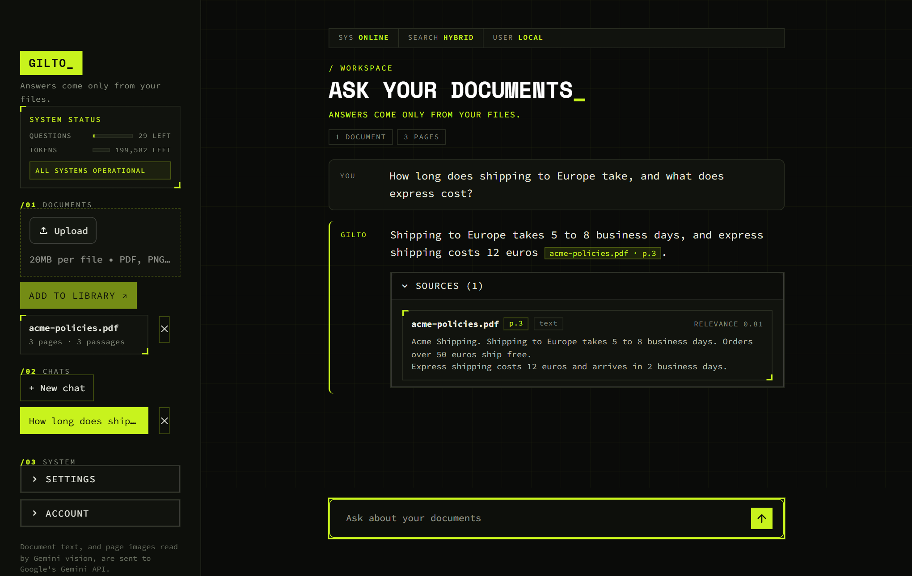
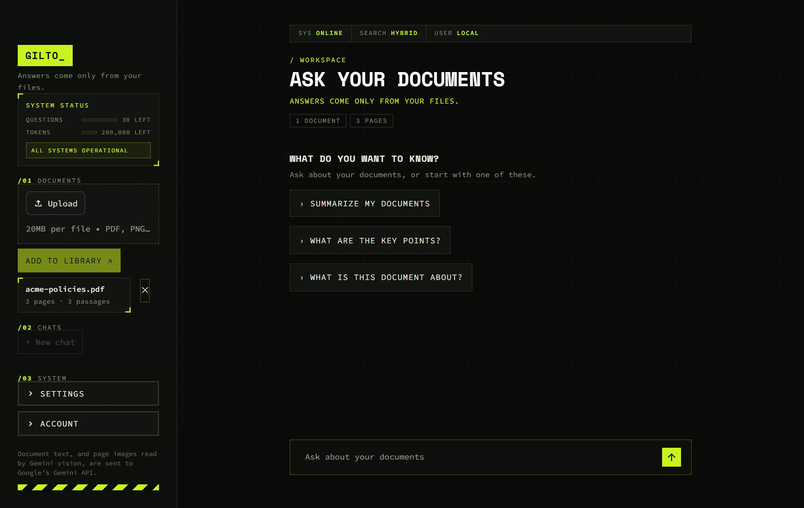
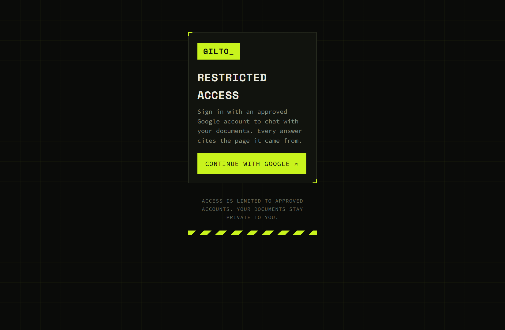
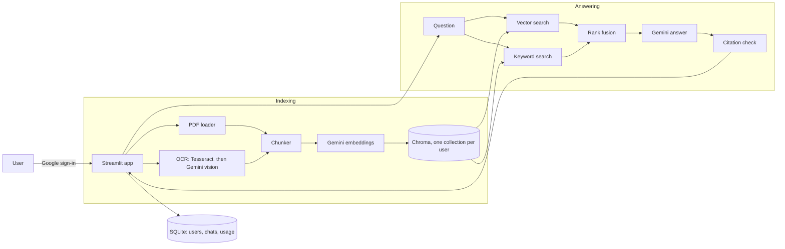

# Gilto

**Upload your documents and chat with them. Every answer comes from your own files and cites the page it came from. If the answer is not in your files, Gilto says so instead of guessing.**

**Live demo:** https://gilto-nanomachine.streamlit.app/ (sign-in is limited to approved Google accounts, and data on this free host is erased when the app restarts or sleeps)


[](https://github.com/900Gang/Gilto/actions/workflows/ci.yml)




<details>
<summary>More screenshots</summary>

| Home, with a document loaded | Sign-in |
|---|---|
|  |  |

</details>

## Try it

Two sample files are in `docs/demo/`: `acme-policies.pdf` (a 3-page text PDF) and `sale-notice.png` (an image with no text layer, so it needs OCR). Upload both and try:

| Ask | You should get |
|---|---|
| How long is the warranty on accessories? | 6 months, cited to `acme-policies.pdf` page 2 |
| When does the spring sale end, and do members get a discount? | 14 April and an extra 15 percent, cited to `sale-notice.png` |
| Who won the 2018 football world cup? | "I couldn't find that in the uploaded documents." |
| Summarize my documents | A cited summary across both files |

A full 90-second walkthrough and an interview pitch are in [`docs/DEMO.md`](docs/DEMO.md).

## What it does

- **Grounded answers with citations.** Replies cite `[file, p.N]`. Every citation is checked against the passages that were actually retrieved, and an invented one is removed.
- **Says "I couldn't find that" when it should.** A similarity threshold and a strict prompt keep it from answering from outside knowledge.
- **PDFs, scans and images.** Text PDFs are read directly. Scanned pages and PNG/JPG files go through OCR: Tesseract first, Gemini vision when Tesseract is missing, unsure, or reads Hindi.
- **Hybrid search.** Vector search plus keyword search (BM25) merged with reciprocal rank fusion, so exact terms such as invoice numbers and names are found too.
- **Whole-document summaries.** "Summarize this", "give me an overview" and "compare" read the full document in parts. A *Search in* picker chooses the documents.
- **English and Hindi.** Questions and answers follow the user's language.
- **Works on phones.** On narrow screens the sidebar becomes a menu, chat tags sit above messages, and buttons get larger touch targets.
- **Many users, each private.** Google sign-in with an email allowlist, a separate library and saved chat history per user, and per-user usage limits.
- **Safe with untrusted documents.** Document text is treated as data, never as instructions, and a hidden instruction inside a PDF is not followed.
- **Self-service privacy.** A consent step before the first upload, "Delete my data", and automatic removal of accounts inactive for 90 days.

## How it works



Gemini calls retry on rate limits and server errors. If the main model is busy or over quota, answers move to a fallback model and then to the fast model, so a question rarely fails outright.

## Quick start

You need Python 3.11 to 3.13 and a Gemini API key from https://aistudio.google.com/apikey.

```bash
git clone https://github.com/900Gang/Gilto.git
cd Gilto
python -m venv .venv
source .venv/Scripts/activate        # Windows Git Bash. On macOS or Linux: source .venv/bin/activate
python -m pip install -r requirements.txt
cp .env.example .env
```

Put your key in `.env` as `GEMINI_API_KEY=...`. Never put it in `.env.example` or any other tracked file.

For a first run without Google sign-in, also add `AUTH_DISABLED=true` to `.env`. That skips sign-in and uses one shared user called `local`. **Use it on your own machine only.**

```bash
python -m streamlit run app.py
```

Open http://localhost:8501, tick the consent box, upload a PDF or image, click **Add to library**, and ask a question.

**Optional: Tesseract for fast local OCR.** Without it, scanned pages are read by Gemini vision, which works but uses one API request per page. On Windows, install it from https://github.com/UB-Mannheim/tesseract/wiki and tick Hindi under additional language data. Gilto finds `C:\Program Files\Tesseract-OCR\tesseract.exe` by itself. Set `TESSERACT_CMD` if it lives elsewhere.

## Google sign-in

1. In Google Cloud Console, create an OAuth client of type **Web application**. Add `http://localhost:8501/oauth2callback` as an authorized redirect URI, and add your own email as a test user.
2. Copy `.streamlit/secrets.toml.example` to `.streamlit/secrets.toml` and fill in `client_id`, `client_secret` and a random `cookie_secret`. This file is ignored by git. Never commit it.
3. In `.env`, remove `AUTH_DISABLED=true` and set `ALLOWED_EMAILS=you@gmail.com,friend@gmail.com`. An empty list lets nobody in.

## Deploy

**Streamlit Community Cloud (free).** Connect the repo at https://share.streamlit.io with `app.py` as the main file. `packages.txt` installs Tesseract. In the app's **Secrets** box, add your settings, with root-level keys above `[auth]`:

```toml
GEMINI_API_KEY = "..."
ALLOWED_EMAILS = "you@gmail.com"
AUTH_DISABLED = "false"
CHROMA_PATH = "/tmp/gilto/chroma_db"
OCR_CACHE_PATH = "/tmp/gilto/ocr_cache"
SQLITE_PATH = "/tmp/gilto/gilto.db"
DEMO_NOTICE = "Demo hosting: uploaded files and chats are erased when the app restarts or sleeps."

[auth]
redirect_uri = "https://YOUR-SUBDOMAIN.streamlit.app/oauth2callback"
cookie_secret = "a-new-random-string"
client_id = "..."
client_secret = "..."
server_metadata_url = "https://accounts.google.com/.well-known/openid-configuration"
```

Add the same redirect URI to your Google OAuth client. **Data on Community Cloud is temporary**: documents, chats and accounts are lost when the app restarts or sleeps, and apps sleep after 12 hours without visitors.

**Render, with Docker.** The repo includes a `Dockerfile`, `start.sh` and `render.yaml`. They keep data on a persistent disk, which needs a paid plan. Create a Blueprint from the repo, enter `GEMINI_API_KEY` and `ALLOWED_EMAILS`, and add the `[auth]` block above as a secret file named `secrets.toml`. To try the image locally:

```bash
docker build -t gilto .
docker run -p 8501:8501 -e AUTH_DISABLED=true -e GEMINI_API_KEY=your-key gilto
```

## Configuration

Every setting is an environment variable. See `.env.example` for the full list.

| Variable | Default | What it does |
|---|---|---|
| `GEMINI_API_KEY` | none | Required. Used for answers, embeddings and vision OCR. |
| `GEMINI_MODEL` / `GEMINI_FALLBACK_MODEL` / `GEMINI_FAST_MODEL` | `gemini-3.8-flash` / `gemini-3.6-flash` / `gemini-3.5-flash-lite` | Main, backup and last-resort answer models. The fast model also rewrites follow-ups and reads scans. |
| `EMBEDDING_PROVIDER` | `gemini` | `gemini` uses the API. `local` runs a model on your machine (`pip install -r requirements-local.txt`, about 1.2 GB of RAM). |
| `SIMILARITY_THRESHOLD` | `0.60` (Gemini), `0.80` (local) | Passages scoring below this are dropped. Leave it unset unless you have measured your own documents. |
| `HYBRID_SEARCH` | `true` | Vector plus keyword search. |
| `ALLOWED_EMAILS` | empty | Who may sign in. |
| `AUTH_DISABLED` | `false` | Local testing only. |
| `HOURLY_QUESTION_LIMIT` / `DAILY_TOKEN_LIMIT` / `MONTHLY_TOKEN_CAP` | `30` / `200000` / `5000000` | Usage limits. `0` turns one off. Tokens are estimated at 3 characters each. |
| `MAX_FILE_MB`, `MAX_PAGES_PER_FILE`, `MAX_DOCS_PER_USER`, `MAX_TOTAL_PAGES` | `20`, `100`, `15`, `500` | Upload limits per user. |
| `INACTIVE_DAYS` | `90` | Accounts not seen for this long are deleted at server start. |
| `OCR_LANGS`, `OCR_CONFIDENCE_THRESHOLD`, `TESSERACT_CMD` | `eng+hin`, `60` | OCR tuning. |

Each embedding model gets its own Chroma collections, so after changing `EMBEDDING_PROVIDER` or the embedding model you need to upload your documents again. Scanned pages are not re-read, because OCR results are cached.

## Testing

```bash
python -m pytest
```

243 tests cover the loader, chunker, OCR routing, store, indexer, hybrid retrieval, summaries, citations, the Gemini client (retries, fallbacks, error messages), embeddings, sign-in rules, database isolation, quotas, retention and the secret scanner. Gemini calls are mocked, so no API key is needed.

**Answer-quality evaluation** runs real questions against the real Gemini API. It is skipped in the normal run.

```bash
python -m pytest -m eval -s
```

It checks that answers contain the expected facts with a citation to the right page, that out-of-scope questions are refused, and that an instruction hidden inside a document is ignored. The pass bar is 90% of answerable questions correct and 100% of out-of-scope questions refused. With no `eval/cases.json` it uses a built-in sample. To test your own documents, put PDFs in `eval/docs/`, copy `eval/cases.example.json` to `eval/cases.json`, and list your documents and questions. Both paths are ignored by git.

## Development

**Automatic checks.** `.github/workflows/ci.yml` runs on every push and pull request. One job runs the tests. A second job scans the working tree with `scripts/check_secrets.py` and the whole git history with [gitleaks](https://github.com/gitleaks/gitleaks).

**Stop secrets before they are committed.** Turn on the commit hook once per clone:

```bash
git config core.hooksPath scripts/hooks
```

From then on `git commit` is blocked if a staged file looks like a key, a client secret or a private key, or if `.env`, `.streamlit/secrets.toml` or a database file is staged. Run the same check on every tracked file with `python scripts/check_secrets.py --all`. The check never prints the secret it found.

## Project structure

```
app.py                  Streamlit UI (layout and state only)
ui.py                   theme CSS and small HTML components
rag/
  config.py             settings from environment variables
  llm.py                Gemini client: streaming, retries, model fallback, vision
  embedder.py           Gemini embeddings and the optional local model
  loader.py  ocr.py     PDF and image reading, Tesseract and vision OCR with a cache
  chunker.py            overlapping chunks with page metadata
  store.py              Chroma wrapper, one collection per user and embedding model
  bm25.py  fusion.py    keyword search and reciprocal rank fusion
  chain.py              retrieval, prompts, summaries, citation checking
  summarize.py          summary detection and batching
  indexer.py            upload to chunks, limits, duplicate detection
  auth.py  db.py        allowlist, SQLite users and chats
  limits.py  retention.py   quotas, data deletion
tests/                  unit tests and the evaluation suite
scripts/                secret scanner and the commit hook
.github/workflows/      CI: tests and secret scanning
Dockerfile  render.yaml  start.sh  packages.txt   deployment files
SPEC.md                 design decisions and their reasons
```

## Privacy and security

- Document text and scanned page images are sent to Google's Gemini API. A consent checkbox appears before the first upload. On Google's free tier, submitted content may be used to improve Google products (check Google's current terms), so use a paid-tier key for confidential documents.
- Each user's documents live in their own collection, and every chat query also checks the owner.
- Secrets stay out of git: `.env` and `.streamlit/secrets.toml` are ignored, the API key is hidden from tracebacks, and a commit hook plus CI scan for leaked keys.
- Original uploaded files are not stored, only extracted text chunks and the OCR cache.

## Status and limitations

**Checked.** The unit tests, live Gemini answers with correct citations and refusals, keyword-only retrieval, summaries, OCR of a scanned PDF and a PNG through Gemini vision, local Tesseract on English, the model fallback chain, the interface in a real browser, and Google sign-in on a local machine.

**Not checked yet.** Hindi OCR on a real scan (the Hindi routing is unit-tested, but accuracy on real pages is unmeasured), building the Docker image, deploying to Render, and a long-running Streamlit Community Cloud deployment.

**Known limits.** Handwriting is not read. A summary covers at most 4 documents and about 100 pages. The similarity threshold was set from a small sample, so measure it again on your own documents. The model IDs come from Google's list at the time of writing and may need updating. Free-tier Gemini keys have low rate limits, so you may see "rate limit or quota was reached" and need to wait a minute.

## Design

The look is a dark, monospace "cyber brutalist" theme with a lime accent, corner brackets, numbered sections and a system-status panel for usage. See `SPEC.md` for the architecture decisions and why each was made.

## License

MIT. See `LICENSE`.
